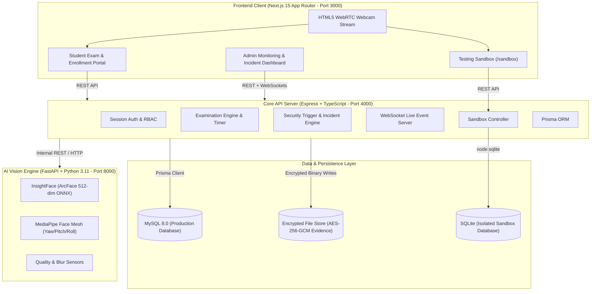

# ExamGuard 🛡️

**Real-Time Multi-Modal AI Exam Proctoring & Biometric Verification System**

ExamGuard is an enterprise-grade, locally runnable examination proctoring platform that ensures academic integrity through continuous biometric facial identity verification. Powered by a high-precision 512-dimensional InsightFace deep neural network and MediaPipe pose estimation, ExamGuard verifies that the student starting an online exam remains the verified student throughout the entire session.

---

## 🌟 Key Highlights & Capabilities

- 📸 **5-Image Biometric Enrollment:** Captures 5 high-resolution face samples to compute an L2-normalized 512-dimensional centroid embedding for maximum accuracy across head rotations.
- ⏱️ **Continuous Real-Time Verification:** Verifies candidate identity every 1.5s during exams with sub-100ms inference latency.
- 🚨 **Autonomous Incident Engine:** Real-time state machine triggers for `IDENTITY_MISMATCH`, `ABSENCE_NO_FACE`, `MULTIPLE_FACES`, and `IMAGE_UNCLEAR`.
- 🔐 **Privacy-First Evidence Archiving:** Zero streaming to external clouds. Evidence snapshots are captured only when security incidents open, encrypted at rest using AES-256-GCM.
- 📡 **Live Proctoring Command Center:** WebSocket-driven live monitoring dashboard with real-time candidate tiles, incident feeds, and side-by-side registered vs. incident evidence comparison.
- 🧪 **Interactive Testing Sandbox (`/sandbox`):** Unauthenticated demonstration environment featuring 5-image enrollment, live threat simulation, and an **isolated SQLite database** (`main/storage/sandbox/sandbox.db`) that guarantees zero pollution of production MySQL.

---

## 🏗️ System Architecture



---

## 📁 Repository Organization

The repository is organized for clean deployment and GitHub hosting:

```
Exam_Guard/
├── README.md               # Project Overview, Architecture, Tech Stack & Quick Start
├── Setup.md                # Complete Step-by-Step Installation & Troubleshooting Guide
├── .gitignore              # Multi-tier gitignore protecting secrets, caches, and models
├── package.json            # Root convenience runner forwarding commands to main/
└── main/                   # Core Monorepo & Application Source Code
    ├── apps/
    │   ├── api/            # Express + Prisma + SQLite Backend Service (Port 4000)
    │   └── web/            # Next.js 15 App Router Frontend Application (Port 3000)
    ├── packages/
    │   └── shared/         # Shared TypeScript DTOs, schemas, enums & contracts
    ├── services/
    │   └── vision/         # Python 3.11 FastAPI + InsightFace Vision Engine (Port 8000)
    ├── scripts/            # Database reset, seeding, verification & doctor scripts
    ├── storage/            # Encrypted evidence files & isolated SQLite sandbox database
    ├── docs/               # System architecture, ADRs, calibration & security audits
    ├── .env.example        # Environment variable template
    ├── docker-compose.yml  # Local MySQL container orchestration
    ├── package.json        # Monorepo workspaces configuration
    └── tsconfig.base.json  # Base TypeScript configuration
```

---

## ⚡ Quick Start

### 1. Prerequisites
- **Node.js:** `>= 20.0.0 LTS` (v22 recommended)
- **Python:** `3.10` or `3.11` (64-bit)
- **MySQL:** `8.0+` running on port `3306`

For detailed prerequisite installation and setup instructions, see [Setup.md](Setup.md).

### 2. Automated Setup (Windows)
Run from the root directory:
```powershell
npm run setup
```

### 3. Launch All Services Concurrently
```bash
npm run run:all
```

| Service | Local URL | Description |
|---|---|---|
| **Web Portal** | `http://localhost:3000` | Student UI, Admin UI, and Testing Sandbox |
| **API Backend** | `http://localhost:4000` | Express REST API & WebSocket Server |
| **Vision AI Engine** | `http://localhost:8000` | InsightFace facial analysis service |

---

## 🧪 Demonstration & Testing Sandbox

ExamGuard includes an **Unauthenticated Testing Sandbox** designed specifically for evaluators and live demonstrations.

- **URL:** Open `http://localhost:3000/sandbox` (or click **"Open Testing Sandbox →"** on the [Login Page](http://localhost:3000/login)).
- **Step 1 — Capture 5 Reference Images:** Use the single-capture or **Auto-Burst 5 Images** button to record reference frames. The system calculates an optimal 512-dim centroid embedding.
- **Step 2 — Live Detection & Testing:** Test real-time live detection against the reference face with interactive threshold calibration (50%–95%).
- **Live Scenarios to Demonstrate:**
  1. 🟢 **Match:** Face camera $\rightarrow$ Live cosine similarity gauge matches identity.
  2. ⚠️ **Absence:** Step away or cover camera $\rightarrow$ Instant `NO_FACE` trigger.
  3. 👥 **Multiple Faces:** Second person enters frame $\rightarrow$ `MULTIPLE_FACES` warning.
  4. 🔴 **Impersonator:** Substitute person sits in $\rightarrow$ `MISMATCH` alert.
- **Dedicated SQLite Database:** All test profiles and logs are stored in `main/storage/sandbox/sandbox.db`, keeping production MySQL completely untouched.

---

## 👥 Default Demo Credentials

| Role | Email | Password | Access Routes |
|---|---|---|---|
| **Administrator / Proctor** | `admin@examguard.local` | `AdminPass123!` | `/admin/dashboard`, `/admin/monitoring`, `/admin/incidents` |
| **Student / Candidate** | `student@examguard.local` | `StudentPass123!` | `/dashboard`, `/enrollment`, `/exams` |
| **Testing Sandbox** | *(No Login Required)* | *(No Auth)* | `/sandbox` (Accessible directly via login page button) |

---

## 🛡️ Security & Privacy Guarantees

- **No Third-Party AI Services:** All vision inference runs 100% locally on-premise via ONNX Runtime without calling paid external APIs.
- **Cryptographic Encryption at Rest:** Facial embeddings and incident evidence photos are encrypted with AES-256-GCM.
- **Evidence Minimization:** Images are never retained during normal verification. Frames are stored only when a critical security incident is opened, limited to one evidence frame per incident.
- **Strict Database Separation:** The testing sandbox operates against a dedicated SQLite database, preventing test pollution of the production MySQL audit trail.

---

## 🧪 Testing & Verification

```bash
# Run all unit and integration test suites
npm run test

# Check database consistency invariants (0 violations)
npm run db:check

# Run production integrity check (no mock bypasses)
node main/scripts/check-no-mocks.mjs
```

---

## 📄 License & Documentation

- Comprehensive Setup Guide: [Setup.md](Setup.md)
- Complete System Architecture: `main/docs/ARCHITECTURE.md`
- Security & Privacy Policies: `main/docs/SECURITY.md` & `main/docs/PRIVACY.md`
- Biometric Calibration & Thresholds: `main/docs/CALIBRATION.md`
