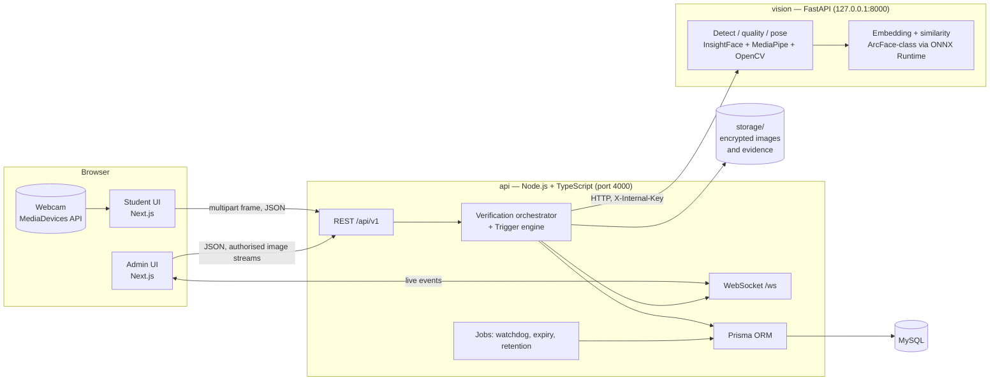
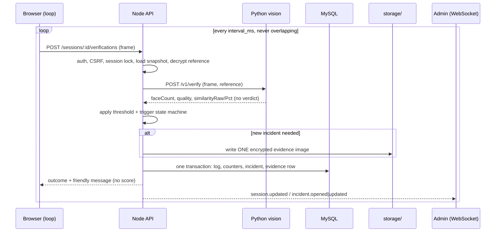
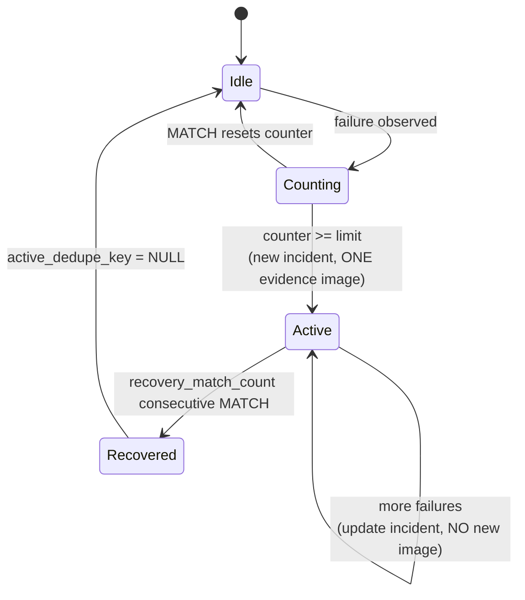
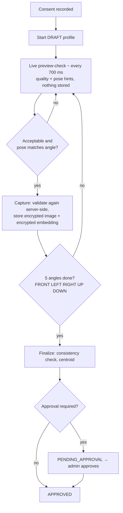

# ExamGuard — Architecture

## 1. Component view



Only `api` reads or writes MySQL and `storage/`. `vision` is stateless. The browser never calls `vision`.

## 2. Continuous verification sequence



## 3. Trigger / incident state machine (per session, per trigger type)



## 4. Enrollment flow



## 5. Storage layout

```
storage/
  enrollment/<aa>/<uuid>.bin      AES-256-GCM encrypted JPEG (IV/tag in MySQL)
  evidence/<aa>/<uuid>.bin        same format; exactly one per incident
  tmp/                            transient; cleaned on startup
```

`<aa>` = first two characters of the UUID. Paths are stored relative to `STORAGE_ROOT`. Nothing in `storage/` is ever served statically.

## 6. Process model on Windows (local)

`npm run dev` → `concurrently` starts: `next dev` (web), `tsx watch` or `nodemon` (api), `uvicorn` from `services/vision/.venv` (vision). MySQL runs as a Windows service (or Docker). `scripts/doctor.ps1` verifies all four.
